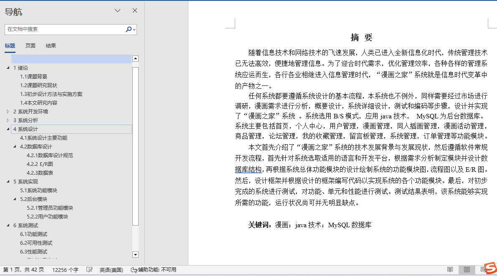
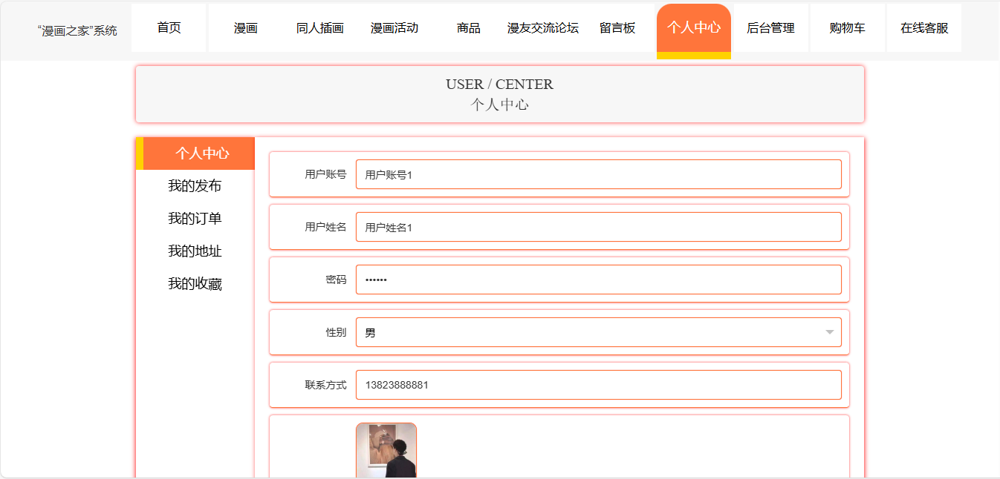
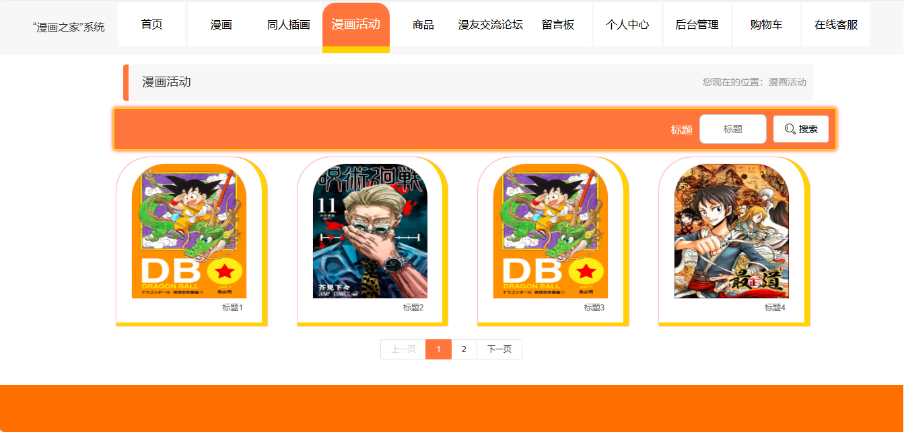
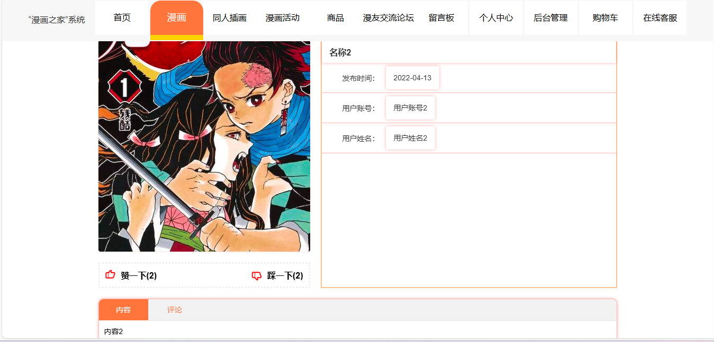
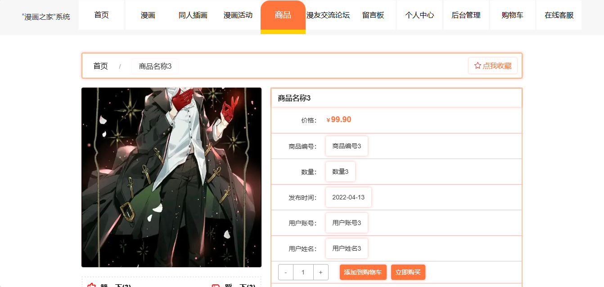
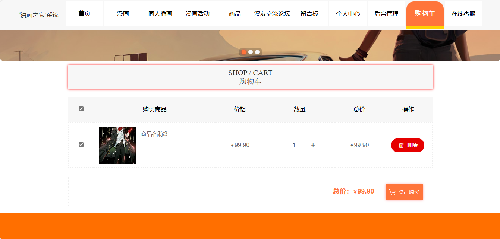
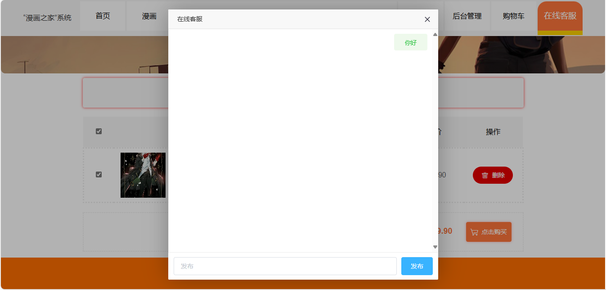
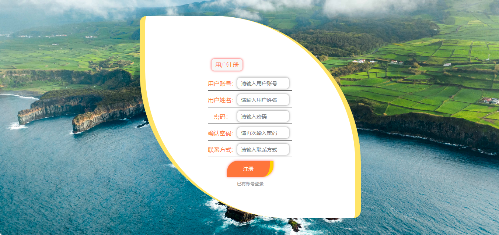
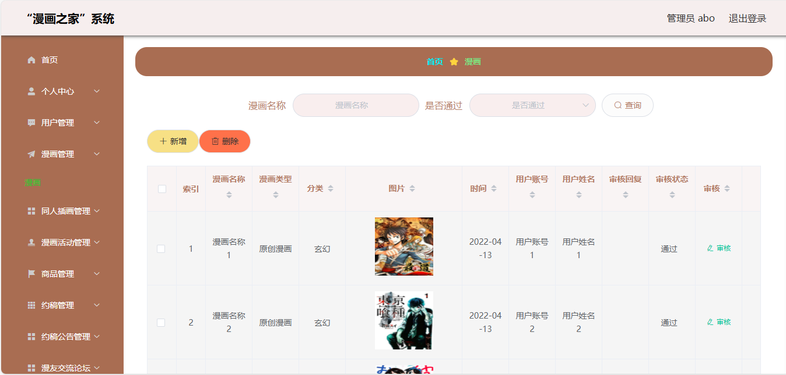
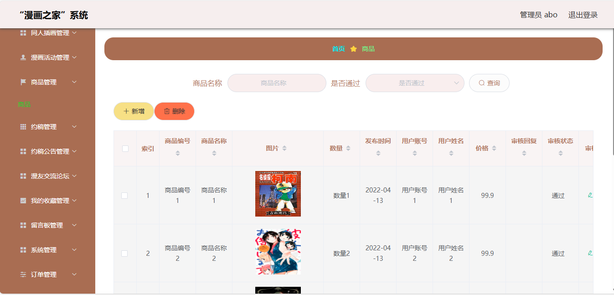

## 基于springboot+vue的漫画之家系统(程序+报告)

###  获取完整源码和sql数据库文件（完全免费）: 微信: littlepinia88 程序员蛙哥
###  所有项目以及源代码本人均调试运行无问题 可支持远程安装部署调试、定制修改、代码讲解

## 项目介绍

本项目是一个基于 Spring Boot + MyBatis-Plus 的漫画之家社区与周边商城系统，面向漫画爱好者的内容分享与同人交易场景，采用「Vue + Element UI + Spring Boot」前后端分离架构，覆盖漫画作品浏览、同人插画、漫画活动、约稿服务、周边商品下单购物车、论坛发帖、在线客服与留言互动的完整业务闭环。后端提供 RESTful JSON 接口，前端为 vue-cli 单页应用，可作为课程设计、毕业设计或内容电商类系统的实践案例。

### 系统角色
- **管理员**：通过 `users` 登录后台，按 `sfsh` 字段审核内容，管理漫画、同人插画、漫画活动、约稿、周边商品、订单以及论坛与留言。
- **用户**：通过 `yonghu` 注册登录，浏览与点赞作品、提交约稿、加入购物车、提交订单、参与论坛、发表评论、收藏并使用在线客服。
- **权限控制**：由 `AuthorizationInterceptor` 基于请求头 `Token` 鉴权，登录后签发 Token 写入 `token` 表；登录、注册与公开浏览接口放行，其余接口需携带有效 Token。

### 用户端功能
1. **注册与登录**：以账号 `yonghuzhanghao`、姓名 `yonghuxingming`、密码 `mima` 注册登录，可维护头像 `touxiang` 与账户余额 `money`。
2. **漫画作品**：按分类 `fenlei`、类型 `manhualeixing` 浏览漫画列表与详情，通过 `/manhua/thumbsup/{id}` 点赞。
3. **同人插画与漫画活动**：浏览同人插画 `tongrenchahua` 与漫画活动 `manhuahuodong` 详情并点赞。
4. **约稿服务**：提交约稿需求 `yuegao`，查看约稿公告 `yuegaogonggao`。
5. **周边商城**：浏览周边商品 `shangpin`（编号 `shangpinbianhao`、库存 `shuliang`、价格 `price`），加入购物车 `cart`、选择收货地址 `address` 后提交订单 `orders`。
6. **互动社区**：发布论坛帖子 `forum`、对漫画/同人插画/商品发表评论（`discussmanhua`、`discusstongrenchahua`、`discussshangpin`）、收藏 `storeup`、留言板 `messages`、与管理员在线客服会话 `chat`。

### 管理端功能
1. **内容审核**：对漫画、同人插画、周边商品等新增内容按 `sfsh`（是否审核）与 `shhf`（审核回复）完成上架审核。
2. **商品与订单管理**：维护周边商品的编号、图片、库存与价格；分页查看订单 `orders`（含 `orderid`、`buynumber`、`total`、`status`、`logistics`）并处理发货。
3. **约稿与活动管理**：维护约稿需求、约稿公告与漫画活动的发布信息。
4. **互动内容管理**：管理论坛帖子、各类评论、留言板与客服会话记录。
5. **用户与字典管理**：维护用户账户、数据字典 `dictionary` 与系统配置 `config`。

### 技术栈
- **后端框架**：Spring Boot 2.2.2.RELEASE、Spring MVC、MyBatis-Plus 2.3（mybatis-spring-boot-starter 2.1.1）
- **数据访问**：MySQL（库 `A004_springbootp68f1`），MyBatis-Plus 注解 + XML Mapper（`classpath*:mapper/*.xml`）
- **前端**：Vue 2.6 + Element UI 2.13 + vue-router + axios + ECharts + vue-quill-editor 富文本
- **工程能力**：`AuthorizationInterceptor` Token 鉴权、`@IgnoreAuth` 放行、POI Excel、Hutool、FastJson、统一跨域响应头
- **构建运行**：Maven 打包可执行 jar；前端 dev server 端口 8081 代理到后端 8080

### 核心数据表
- `yonghu` 用户表：`yonghuzhanghao`、`mima`、`yonghuxingming`、`money`、`touxiang`
- `manhua` 漫画表：`manhuamingcheng`、`manhualeixing`、`fenlei`、`neirong`、`sfsh`、`thumbsupnum`
- `shangpin` 周边商品表：`shangpinbianhao`、`shangpinmingcheng`、`shuliang`、`price`、`sfsh`
- `orders` 订单表：`orderid`、`userid`、`goodid`、`buynumber`、`total`、`status`、`address`、`consignee`、`logistics`
- `cart` 购物车表：`userid`、`goodid`、`goodname`、`buynumber`、`price`
- `tongrenchahua` 同人插画表、`manhuahuodong` 漫画活动表、`yuegao` 约稿表、`forum` 论坛表、`address` 收货地址表

### 工程结构
```
A004springbootp68f1
├── src/main/java/com
│   ├── controller/      REST 控制器（漫画、商品、订单、购物车、约稿、论坛、客服、留言等）
│   ├── service/         业务接口与 impl 实现
│   ├── dao/             MyBatis-Plus Mapper 接口
│   ├── entity/          实体类（含 TokenEntity）
│   ├── interceptor/     AuthorizationInterceptor Token 鉴权
│   ├── config/          拦截器注册、MyBatis-Plus 配置
│   ├── annotation/      @IgnoreAuth 放行注解
│   └── utils/           R 响应封装、文件等工具
├── src/main/resources
│   ├── application.yml   端口 8080、上下文 /springbootp68f1、数据源
│   ├── mapper/          MyBatis XML 映射
│   ├── static/upload/    上传文件目录
│   └── admin/admin/      Vue 管理端工程（src 源码 + dist 打包产物）
└── pom.xml
```

### 访问入口
- 后端接口：`http://localhost:8080/springbootp68f1/`（如 `/users/login`、`/manhua/page`）
- 前端开发调试：`http://localhost:8081/`（vue.config.js devServer，代理 `/springbootp68f1` 到 8080）

### 补充说明
- 数据库账号密码默认为 root/123456，首次运行需先创建并导入 `A004_springbootp68f1` 库结构。
- 订单的支付与发货为流程模拟，未接入真实支付与物流渠道；审核状态字段（`sfsh`/`shhf`）为字典枚举。
- 鉴权为自研 Token 机制，密码以明文形式入库，仅适合教学演示。

## 运行环境
- JDK版本：JDK1.8及以上
- 开发工具：IDEA、Ecplise、Myecplise都可以
- 数据库: MySQL5.7及以上
- Node：14.14.0及以上

## 运行截图



















